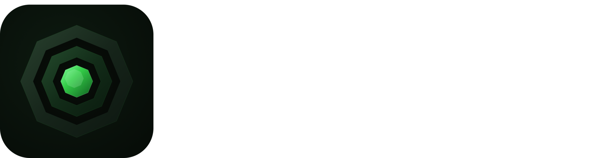
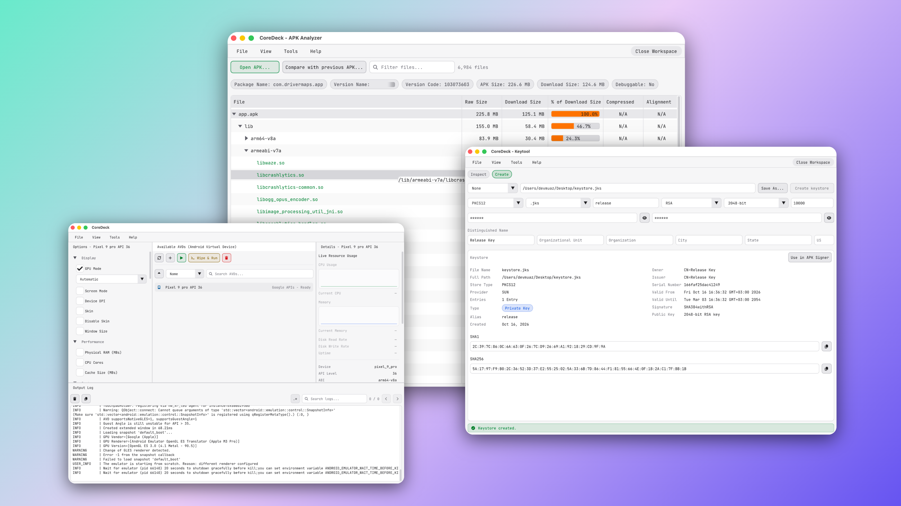
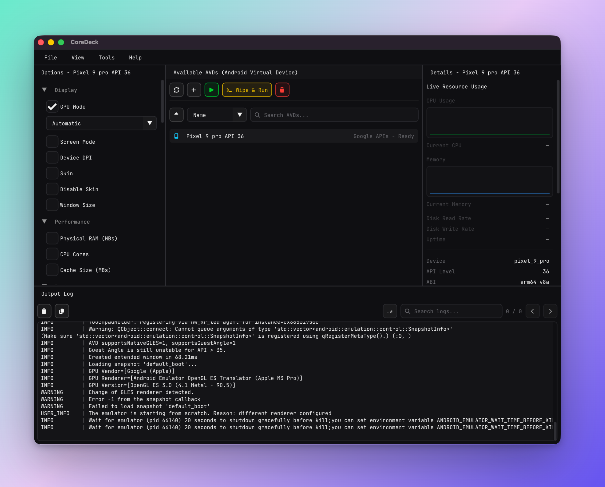
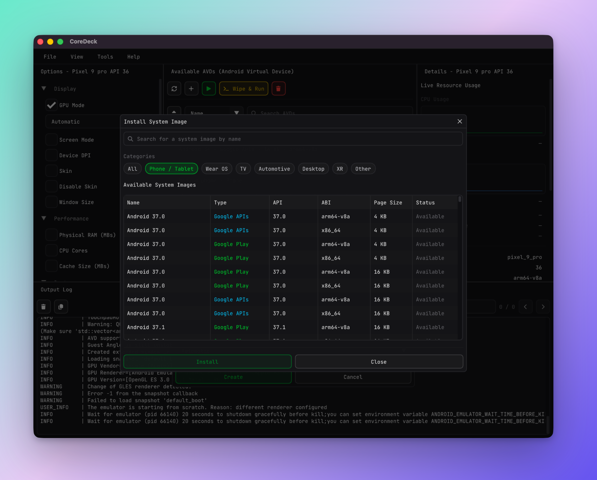
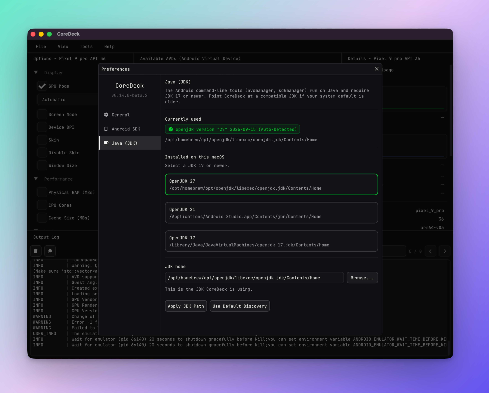
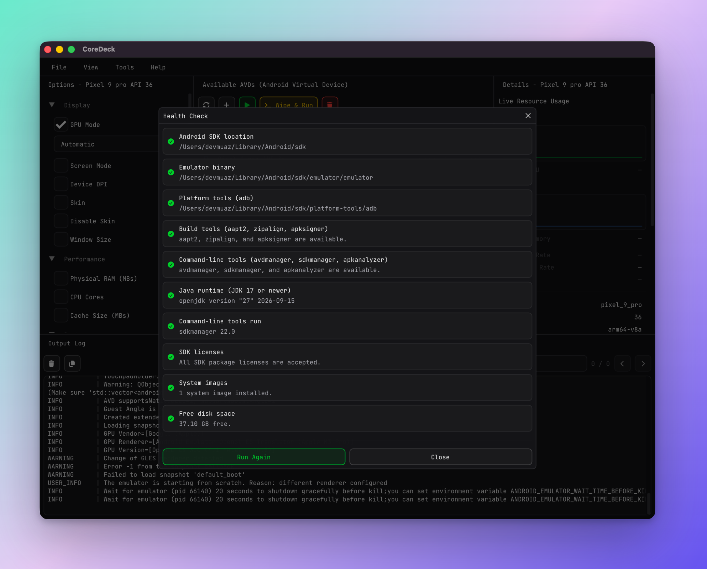
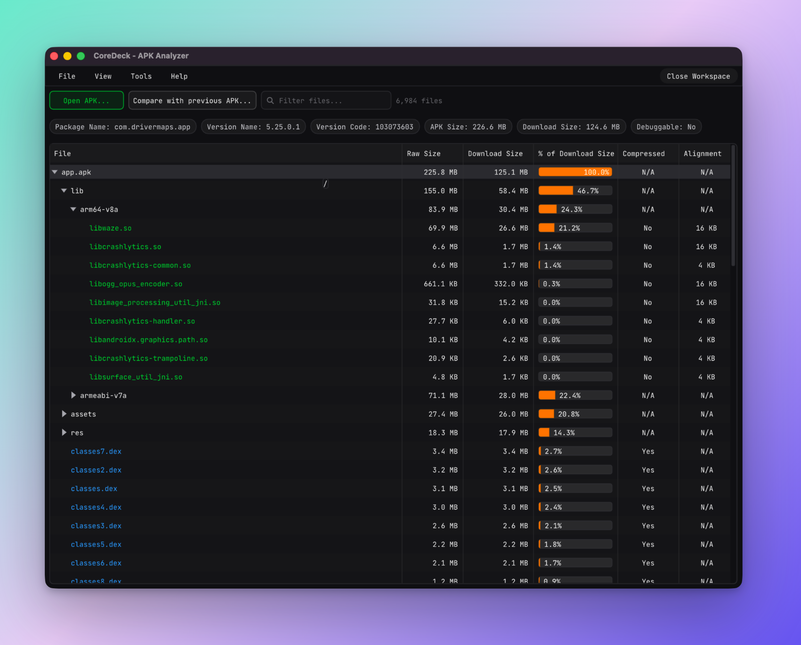
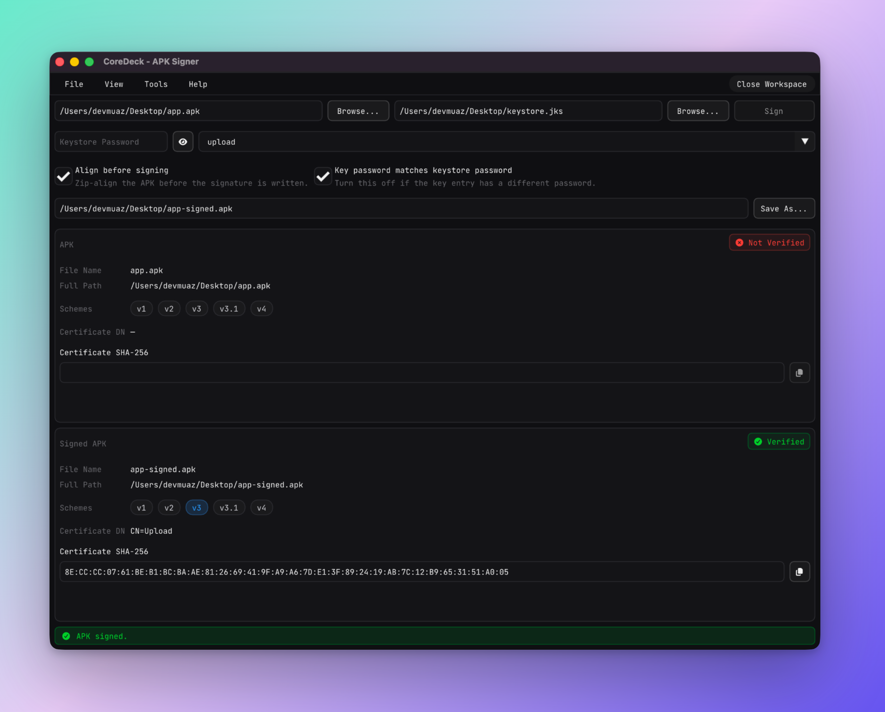
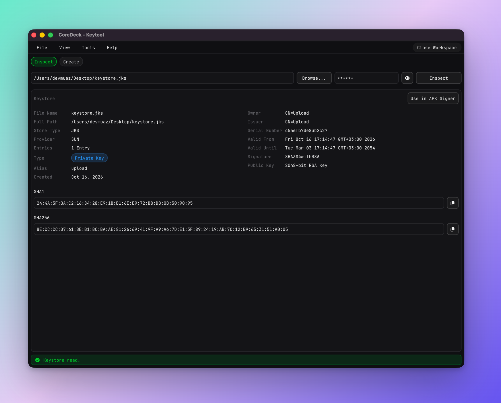
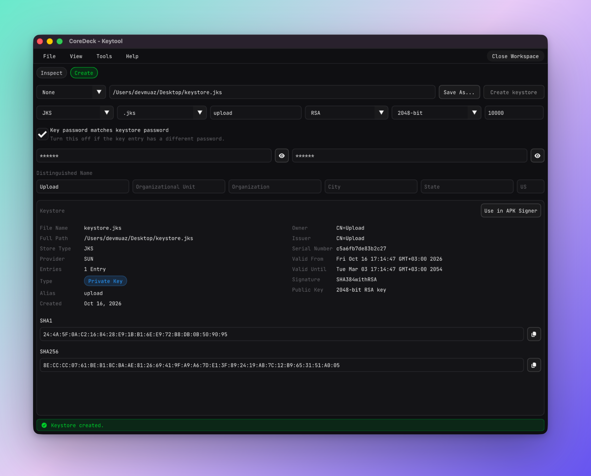

<div align="center">
  
  <br /><br />
  <a href="https://www.producthunt.com/products/coredeck?embed=true&amp;utm_source=badge-featured&amp;utm_medium=badge&amp;utm_campaign=badge-coredeck" target="_blank" rel="noopener noreferrer"></a>
</div>

<br />

[](https://github.com/devmuaz/CoreDeck/actions/workflows/build.yml)
[](https://github.com/devmuaz/CoreDeck/actions/workflows/release.yml)
[](https://github.com/devmuaz/CoreDeck/releases)
[](https://github.com/devmuaz/CoreDeck/releases)
[](https://github.com/devmuaz/CoreDeck/releases)
[](https://github.com/devmuaz/CoreDeck/stargazers)
[](https://github.com/devmuaz/CoreDeck/issues)


[](LICENSE)

[CoreDeck](https://coredeck.dev) is a native desktop command center for the Android SDK. Create virtual devices, launch them, install system images, inspect and sign APKs, create keystores, and see whether your tools are actually ready, all in one fast app. It drives Google's official `emulator`, `avdmanager`, `sdkmanager`, `apkanalyzer`, `apksigner`, and `zipalign` itself, and the JDK's `keytool`. Android Studio does not need to be installed. Built with C++20 and Dear ImGui.

> Bring an SDK you already have, or let CoreDeck download Google's tools and set them up for you.

<p align="center">
  
</p>

## Features

- **AVD Management** — Create, delete, and browse your Android Virtual Devices
- **System Image Management** — List, install, and uninstall Android system images with ease
- **Emulator Control** — Launch, stop, or wipe & run AVDs with one click
- **Per-AVD Options** — Configure GPU, RAM, CPU cores, camera, network, boot mode, and more
- **Live Log Viewer** — Stream emulator output in real time with search and auto-scroll
- **Storage Overview** — Inspect per-AVD disk usage and clear heavy or unused data
- **Health Check** — Reviews the SDK, emulator, platform-tools, build-tools, command-line tools, JDK, licenses, system images, and free disk space, and offers a fix for each problem
- **APK Analyzer** — Opens an APK with the official `apkanalyzer` and shows package info, download size, compression, and alignment
- **APK Signer** — Verifies an APK and signs a new copy with the official `apksigner` and `zipalign`. The original APK is left unchanged, and the report shows which of the v1, v2, v3, v3.1, and v4 schemes verified
- **Java Keytool** — Creates and inspects keystores with the JDK's `keytool`. Templates fill the Flutter upload, Android release, and Android debug recipes, and a private-key entry can be opened in APK Signer
- **SDK Auto-Detection** — Picks up your Android SDK from environment variables or standard paths
- **SDK Installer** — Downloads Google's official command-line tools and installs the platform tools and emulator, without Android Studio
- **JDK Configuration** — Auto-detects a compatible JDK and lets you point at a specific one when your system default is too old
- **Guided Setup** — Onboarding wizard to install or locate the SDK on first run
- **Cross-Platform** — Runs natively at speed of light on Windows, macOS, and Linux

## Preview

<table>
  <tr>
    <td width="50%" align="center" valign="top">
      
      <br />
      <strong>AVD List</strong>
      <br />
      <em>Browse devices and run emulators</em>
    </td>
    <td width="50%" align="center" valign="top">
      
      <br />
      <strong>Create AVD</strong>
      <br />
      <em>Choose an image, device, and name</em>
    </td>
  </tr>
  <tr>
    <td width="50%" align="center" valign="top">
      
      <br />
      <strong>Preferences</strong>
      <br />
      <em>Point CoreDeck at a JDK and the SDK</em>
    </td>
    <td width="50%" align="center" valign="top">
      
      <br />
      <strong>Health Check</strong>
      <br />
      <em>Review the SDK and fix what is missing</em>
    </td>
  </tr>
  <tr>
    <td width="50%" align="center" valign="top">
      
      <br />
      <strong>APK Analyzer</strong>
      <br />
      <em>Package size, compression, and alignment</em>
    </td>
    <td width="50%" align="center" valign="top">
      
      <br />
      <strong>APK Signer</strong>
      <br />
      <em>Verify a signature and sign a new APK</em>
    </td>
  </tr>
  <tr>
    <td width="50%" align="center" valign="top">
      
      <br />
      <strong>Inspect Keystore</strong>
      <br />
      <em>Entries, certificates, and fingerprints</em>
    </td>
    <td width="50%" align="center" valign="top">
      
      <br />
      <strong>Create Keystore</strong>
      <br />
      <em>Flutter and Android keystore templates</em>
    </td>
  </tr>
</table>

## Downloads

On macOS and Linux, the easiest way to install is with Homebrew:

```bash
# macOS (Apple Silicon and Intel)
brew install --cask devmuaz/tap/coredeck

# Linux (arm64 and x86-64)
brew install devmuaz/tap/coredeck
```

You can also grab the latest prebuilt binaries from the official [CoreDeck](https://coredeck.dev) website or the [Releases](https://github.com/devmuaz/CoreDeck/releases) page:

| Platform | Architecture                          | File            |
| -------- | ------------------------------------- | --------------- |
| Windows  | x86-64                                | `.msi` / `.zip` |
| macOS    | arm64 (Apple Silicon), x86-64 (Intel) | `.dmg`          |
| Linux    | x86-64, arm64                         | `.tar.gz`       |

Each release artifact ships with a matching `.sha256` checksum for download verification.

## Requirements

- **Android SDK** with `emulator`, `avdmanager`, `sdkmanager`, `apkanalyzer`, and build-tools (`apksigner`, `zipalign`) available. CoreDeck can install these for you from the onboarding wizard, or you can use an existing SDK (for example one installed via Android Studio).
- **JDK 17+** — the `avdmanager`, `sdkmanager`, and `keytool` command-line tools are Java programs and require JDK 17 or newer. CoreDeck auto-detects a suitable JDK (including the one bundled with Android Studio) and lets you select a specific one under **Preferences, Java (JDK)** if your system default is older.
- **OS:** Windows 10/11, macOS 12+ (Apple Silicon and Intel), or a recent Linux distribution.

## Build from source

CoreDeck builds with **CMake + Ninja** on all platforms. Output is single-config: `build-debug/` and `build-release/` contain the binary directly, with a `compile_commands.json` for editor tooling.

### Prerequisites

All platforms need **CMake 3.23+**, **Ninja**, and **Git** (with submodule support). Per-platform compiler:

| Platform | Compiler              | Install                                                                                                                                                                           |
| -------- | --------------------- | --------------------------------------------------------------------------------------------------------------------------------------------------------------------------------- |
| macOS    | Apple Clang           | `xcode-select --install`, then `brew install cmake ninja`                                                                                                                         |
| Windows  | MSVC 19.30+ (VS 2022) | [Build Tools for VS 2022](https://visualstudio.microsoft.com/downloads/), then the _Desktop development with C++_ workload. Then `winget install Kitware.CMake Ninja-build.Ninja` |
| Linux    | GCC 11+ / Clang 14+   | `sudo apt-get install build-essential cmake ninja-build libcurl4-openssl-dev libgl1-mesa-dev libx11-dev libxrandr-dev libxinerama-dev libxcursor-dev libxi-dev libxext-dev`       |

### Clone and build

```bash
git clone --recursive https://github.com/devmuaz/CoreDeck.git
cd CoreDeck
cmake -S . -B build-release -G Ninja -DCMAKE_BUILD_TYPE=Release
cmake --build build-release --parallel
```

If you already cloned without `--recursive`:

```bash
git submodule update --init --recursive
```

> **Windows note:** Ninja + MSVC needs `cl.exe` on PATH. Run the commands from the **Developer Command Prompt for VS 2022** (Start Menu), or launch VS Code / Cursor from it so the bundled tasks pick up the environment. The provided VS Code tasks handle this automatically via `vswhere` + `Enter-VsDevShell`.

### Run

```bash
# macOS
open build-release/CoreDeck.app

# Linux
./build-release/CoreDeck

# Windows
.\build-release\CoreDeck.exe
```

### Develop in VS Code or Cursor

The repo ships pre-configured `.vscode/` settings (build tasks, launch configs, IntelliSense). Open the project, accept the recommended extensions when prompted, then press **F5** to build and debug.

**Per-editor extensions** — the two editors use different language servers and debuggers:

| Editor                      | Install                                                        | Purpose                                                                           |
| --------------------------- | -------------------------------------------------------------- | --------------------------------------------------------------------------------- |
| **VS Code**                 | `ms-vscode.cpptools`, `ms-vscode.cmake-tools`                  | IntelliSense + CMake integration + `cppvsdbg` (Microsoft MSVC debugger)           |
| **VS Code** _(optional)_    | `vadimcn.vscode-lldb`                                          | Adds LLDB debugger as an alternative to MSVC                                      |
| **Cursor**                  | `llvm-vs-code-extensions.vscode-clangd`, `vadimcn.vscode-lldb` | clangd IntelliSense + LLDB debugger (Microsoft's `cppvsdbg` is locked to VS Code) |
| **Cursor** _(Windows only)_ | LLVM toolchain — `winget install LLVM.LLVM`                    | Provides the `clangd.exe` binary for the extension                                |

**Launch configurations** in the Run & Debug panel:

| Name                                | Editors           | Debugger        |
| ----------------------------------- | ----------------- | --------------- |
| `CoreDeck (Debug) [macOS]`          | VS Code or Cursor | `cppdbg` + LLDB |
| `CoreDeck (Debug) [Windows · MSVC]` | VS Code only      | `cppvsdbg`      |
| `CoreDeck (Debug) [Windows · LLDB]` | VS Code or Cursor | CodeLLDB        |

Each has a matching Release entry and `CoreDeck Tests (...)` variant for the Catch2 test suite. Cursor on Windows should pick the `LLDB` entries; VS Code on Windows can pick either (MSVC is the better PDB-aware option when available).

The first build is a full from-scratch compile of all bundled dependencies (sentry-native, Dear ImGui, GLFW, reflect-cpp, etc.). Subsequent builds are incremental and fast.

## FAQ

**The app starts but says my Android SDK isn't detected.**
CoreDeck looks at `ANDROID_HOME` / `ANDROID_SDK_ROOT` and standard install paths. If your SDK lives elsewhere, point it
at the right location through the onboarding wizard or set the environment variable before launching. If you don't have
an SDK at all, choose **Install SDK...** and CoreDeck will download it for you.

**Can CoreDeck install the Android SDK for me?**
Yes. When no SDK is found, the onboarding wizard offers to install one. CoreDeck downloads Google's official command-line tools archive (verified against a pinned SHA-256), extracts it to a folder you choose, accepts the SDK licenses, and then installs `platform-tools`, `emulator`, and `build-tools` with `sdkmanager`. A **JDK 17 or newer** must already be present, since the command-line tools are Java programs — the wizard asks you to pick one if none is detected. The install is self-contained: CoreDeck remembers the location for itself and never modifies your `PATH`, `ANDROID_HOME`, or `JAVA_HOME`.

**Creating AVDs or installing system images fails, or nothing happens.**
`avdmanager` and `sdkmanager` require **JDK 17 or newer**. If your default `java` is older (e.g. JDK 8/1.8), these tools fail even when the SDK is fine. CoreDeck warns you when it detects an incompatible JDK — open **Preferences, Java (JDK)** and point it at a compatible JDK (the one bundled with Android Studio works well). CoreDeck runs the tools with that JDK via `JAVA_HOME` without changing your global default.

**An emulator won't launch / boots forever.**
Make sure the matching system image is installed and that hardware acceleration is enabled (HAXM/Hyper-V on Windows,
Hypervisor.framework on macOS, KVM on Linux). The live log viewer usually shows the underlying error from `emulator`.

**Does CoreDeck replace Android Studio?**
Not in general. CoreDeck wraps the same official command-line tools that Android Studio uses, and it can install those tools for you — so for AVDs, emulators, APK inspection and signing, and keystores you don't need Android Studio at all. It is not an IDE though: writing, building, and debugging Android apps still needs Android Studio (or Gradle plus your own editor).

## Contributing

See [CONTRIBUTING.md](CONTRIBUTING.md) for the branching model, PR guidelines, and how to get started.

## Acknowledgements

CoreDeck is built on top of these excellent open source projects:

- [Dear ImGui](https://github.com/ocornut/imgui) — immediate-mode GUI
- [GLFW](https://github.com/glfw/glfw) — windowing and input
- [reflect-cpp](https://github.com/getml/reflect-cpp) — reflection and serialization
- [tinyfiledialogs](https://sourceforge.net/projects/tinyfiledialogs/) — native file dialogs
- [Catch2](https://github.com/catchorg/Catch2) — testing framework
- [sentry-native](https://github.com/getsentry/sentry-native) — crash reporting

## License

See [LICENSE](LICENSE) for details.
